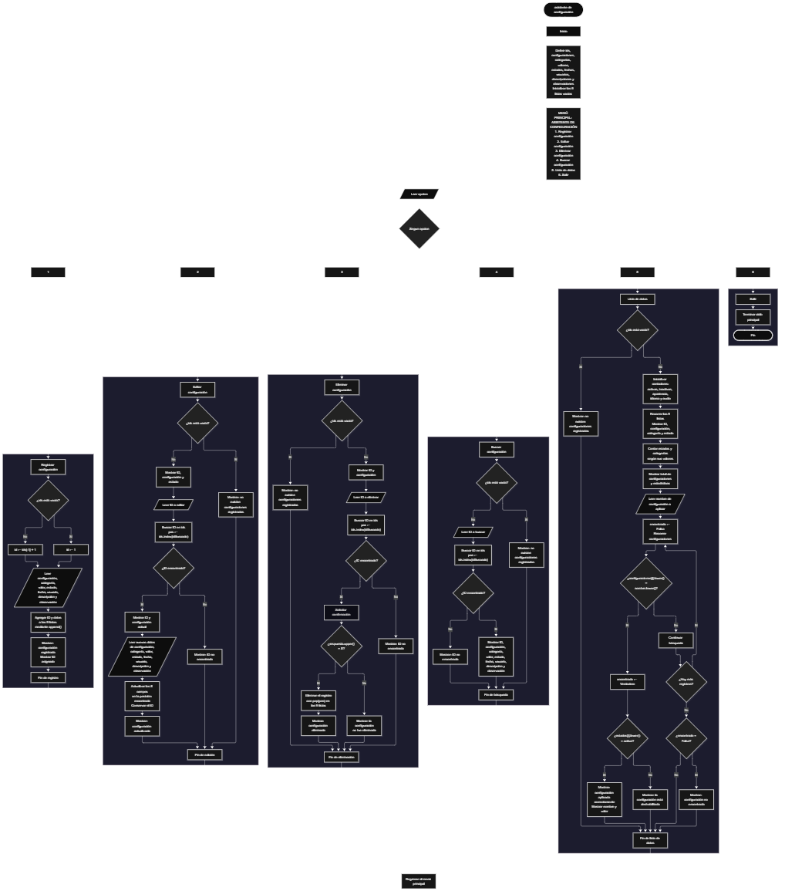

Este proyecto, llamado <b>asistente de configuración</b>, fue desarrollado en <b>python</b> como un ejercicio práctico para fortalecer la lógica de programación mediante la creación de un sistema de gestión de configuraciones desde la consola. El programa cuenta con un menú principal de seis opciones que permite <b>registrar, editar, eliminar, buscar y consultar la información</b> de las configuraciones almacenadas. Cada configuración contiene datos como el nombre, la categoría, el valor, el estado, la fecha de creación, el usuario responsable, la descripción y las observaciones, utilizando nueve listas paralelas para organizar los registros durante la ejecución. Durante su desarrollo se aplicaron conceptos fundamentales de programación, como variables, listas, estructuras condicionales, ciclos repetitivos y métodos para agregar, modificar, buscar y eliminar información. Este proyecto permite poner en práctica los conocimientos adquiridos en python y sirve como base para desarrollar sistemas de gestión más avanzados utilizando otros lenguajes y tecnologías.

<h2 align="center">⚙️ Funcionamiento del menú principal</h2>

### ➕ Registrar configuración

La opción <b>1) registrar configuración</b> permite almacenar una nueva configuración en el sistema. Antes de realizar el registro, el programa comprueba si la lista <b>ids</b> está vacía mediante la condición <b>len(ids) == 0</b>. Si no existen configuraciones registradas, asigna el identificador <b>1</b> a la nueva configuración. En caso contrario, genera el siguiente identificador utilizando la expresión <b>ids[-1] + 1</b>, tomando como referencia el último ID almacenado. Después, solicita el <b>nombre de la configuración, categoría, valor, estado, fecha de creación, usuario responsable, descripción y observación</b>. Los datos se almacenan en sus respectivas listas mediante el método <b>append()</b>, manteniendo la misma posición para representar la información de una configuración. Finalmente, muestra el mensaje <b>"configuración registrada correctamente."</b> y presenta el identificador asignado al nuevo registro.

### ✏️ Editar configuración

La opción <b>2) editar configuración</b> permite modificar la información de una configuración registrada. Primero, el programa comprueba si existen registros almacenados mediante la función <b>len()</b>. Si la lista está vacía, muestra el mensaje <b>"no existen configuraciones registradas."</b>. En caso contrario, presenta una lista con el ID, nombre y estado de cada configuración utilizando un ciclo <b>for</b>. Después, solicita el ID de la configuración que se desea editar y convierte el valor introducido a un número entero mediante <b>int()</b>. A continuación, comprueba si el identificador existe en la lista <b>ids</b> utilizando el operador <b>in</b>. Si existe, obtiene su posición mediante el método <b>index()</b>, muestra algunos de los datos actuales y solicita el nuevo nombre, categoría, valor, estado, fecha, usuario responsable, descripción y observación. Los nuevos valores se asignan directamente a las posiciones correspondientes de las listas, conservando el ID original. Finalmente, presenta el mensaje <b>"configuración actualizada correctamente."</b>. Si el identificador no existe, muestra el mensaje <b>"id no encontrada."</b>.

### 🗑️ Eliminar configuración

La opción <b>3) eliminar configuración</b> permite eliminar una configuración registrada mediante su identificador. Antes de comenzar, el programa comprueba si existen configuraciones almacenadas. Si la lista está vacía, muestra el mensaje <b>"no existen configuraciones registradas."</b>. Si existen registros, presenta una lista con los ID y nombres de las configuraciones. Después, solicita el identificador que se desea eliminar y lo convierte a entero mediante <b>int()</b>. El programa comprueba si el ID existe en la lista <b>ids</b> y obtiene su posición utilizando <b>index()</b>. Si la configuración existe, muestra su identificador y nombre, y solicita confirmación mediante una respuesta de tipo <b>s/n</b>. Para comprobar la confirmación, utiliza la expresión <b>respuesta.upper() == "S"</b>, que permite reconocer la letra S tanto en mayúscula como en minúscula. Si el usuario confirma, utiliza el método <b>pop()</b> para eliminar la posición correspondiente de las nueve listas: <b>ids, configuraciones, categorias, valores, estados, fechas, usuarios, descripciones y observaciones</b>. Finalmente, muestra el mensaje <b>"configuración eliminada correctamente."</b>. Si el usuario no confirma la operación, presenta el mensaje <b>"la configuración no fue eliminada."</b>. Si el identificador no existe, informa que el ID no fue encontrado.

### 🔎 Buscar configuración

La opción <b>4) buscar configuración</b> permite localizar una configuración mediante su identificador. Primero, el programa comprueba si existen configuraciones registradas. Si no hay registros, muestra el mensaje <b>"no existen configuraciones registradas."</b>. En caso contrario, solicita el ID que se desea consultar y convierte el valor introducido a entero mediante <b>int()</b>. A continuación, comprueba si el identificador existe en la lista <b>ids</b> utilizando el operador <b>in</b>. Cuando encuentra una coincidencia, obtiene la posición correspondiente mediante <b>index()</b> y muestra toda la información almacenada: <b>ID, configuración, categoría, valor, estado, fecha, usuario, descripción y observación</b>. Si el identificador introducido no corresponde a ninguna configuración registrada, presenta el mensaje <b>"id no encontrada."</b>. Esta función facilita consultar individualmente los datos de cualquier configuración almacenada.

### 📋 Lista de datos

La opción <b>5) lista de datos</b> permite visualizar las configuraciones registradas, consultar sus estadísticas y buscar una configuración por su nombre. Primero, el programa comprueba si existen registros almacenados. Si la lista está vacía, muestra el mensaje <b>"no existen configuraciones registradas."</b>. En caso contrario, inicializa cinco contadores en cero: <b>activas, inactivas, apariencia, idioma y audio</b>. Después, utiliza un ciclo <b>for</b> para recorrer las listas y mostrar el ID, nombre, categoría y estado de cada configuración. Durante el recorrido, utiliza el método <b>lower()</b> para comparar los estados y las categorías sin distinguir entre letras mayúsculas y minúsculas. Cuando encuentra el estado <b>"activa"</b>, incrementa el contador de configuraciones activas; cuando encuentra <b>"inactiva"</b>, incrementa el contador correspondiente. De igual manera, contabiliza las categorías <b>"apariencia", "idioma" y "audio"</b>. Al finalizar el recorrido, presenta la cantidad total de configuraciones mediante <b>len(ids)</b> y muestra las estadísticas obtenidas. Posteriormente, solicita el nombre de la configuración que se desea aplicar. Para realizar esta búsqueda, inicializa la variable lógica <b>encontrado</b> con el valor <b>False</b> y recorre la lista <b>configuraciones</b>, comparando los nombres mediante <b>lower()</b>. Si encuentra una coincidencia, cambia la variable a <b>True</b> y comprueba el estado de la configuración. Si está activa, muestra el mensaje <b>"configuración aplicada correctamente."</b> y presenta el nombre y el valor almacenado. Si está inactiva, informa que la configuración está deshabilitada. Después utiliza <b>break</b> para finalizar la búsqueda tras encontrar la primera coincidencia. Si no encuentra ninguna configuración con el nombre introducido, muestra el mensaje <b>"configuración no encontrada."</b>.

### 🚪 Salir del menú principal

La opción <b>6) salir</b> permite finalizar la ejecución del programa. Cuando el usuario selecciona esta opción, el sistema muestra el mensaje <b>"gracias por utilizar el asistente de configuración."</b> y utiliza la instrucción <b>break</b> para terminar el ciclo repetitivo <b>while True</b>. De esta manera, se detiene el menú principal y finaliza la ejecución del asistente de configuración.

<h2 align="center">🧠 Temas aplicados en el proyecto</h2>

### 📦 Variables

En este proyecto se utilizan variables para almacenar los datos introducidos por el usuario, controlar las operaciones del menú principal, identificar las configuraciones registradas, seleccionar las posiciones de los registros que se desean modificar o eliminar y realizar los cálculos de las estadísticas. Cada variable cumple una función específica dentro de las diferentes operaciones del sistema.

🔢 **Opcion:** Almacena la opción seleccionada por el usuario en el menú principal.

🆔 **Id_configuracion:** Almacena el identificador asignado a una nueva configuración.

🔎 **Id_buscar:** Almacena el identificador introducido por el usuario para localizar una configuración.

📍 **Posicion:** Almacena la posición del registro encontrado dentro de las listas.

📝 **Configuracion:** Almacena el nombre de la configuración que se está registrando.

📂 **Categoria:** Almacena la categoría correspondiente a la configuración.

⚙️ **Valor:** Almacena el valor asignado a la configuración.

🔘 **Estado:** Almacena el estado de la configuración, que puede ser activa o inactiva.

📅 **Fecha:** Almacena la fecha de creación de la configuración.

👤 **Usuario:** Almacena el usuario responsable de la configuración.

📄 **Descripcion:** Almacena la descripción de la configuración.

📌 **Observacion:** Almacena las observaciones adicionales del registro.

🔄 **I:** Funciona como contador en los ciclos <b>for</b> y permite recorrer las posiciones de las listas.

🔢 **Activas:** Contabiliza las configuraciones cuyo estado corresponde a activa.

🔢 **Inactivas:** Contabiliza las configuraciones cuyo estado corresponde a inactiva.

📊 **Apariencia:** Contabiliza las configuraciones pertenecientes a la categoría apariencia.

📊 **Idioma:** Contabiliza las configuraciones pertenecientes a la categoría idioma.

📊 **Audio:** Contabiliza las configuraciones pertenecientes a la categoría audio.

🔎 **Nombre:** Almacena el nombre introducido por el usuario para buscar una configuración.

✅ **Encontrado:** Variable lógica que indica si se encontró una configuración con el nombre solicitado.

### 🗃️ Listas

En este proyecto se utilizan nueve listas relacionadas con los datos de cada configuración. Todas comienzan vacías y almacenan la información de manera organizada mediante posiciones coincidentes. Esto significa que los datos ubicados en una misma posición de las listas pertenecen a una misma configuración. Por ejemplo, la información de un registro almacenado en la posición <b>0</b> se encuentra distribuida entre <b>ids[0], configuraciones[0], categorias[0], valores[0], estados[0], fechas[0], usuarios[0], descripciones[0] y observaciones[0]</b>. Esta organización permite recorrer, buscar, modificar, mostrar y eliminar las configuraciones de manera ordenada.

🆔 **Ids:** Almacena los identificadores de las configuraciones registradas.

⚙️ **Configuraciones:** Almacena los nombres de las configuraciones.

📂 **Categorias:** Almacena las categorías de cada configuración.

🔢 **Valores:** Almacena los valores asignados a las configuraciones.

🔘 **Estados:** Almacena los estados de las configuraciones.

📅 **Fechas:** Almacena las fechas de creación de los registros.

👤 **Usuarios:** Almacena los usuarios responsables de las configuraciones.

📄 **Descripciones:** Almacena las descripciones de las configuraciones.

📌 **Observaciones:** Almacena las observaciones adicionales de cada registro.

### 🔀 Estructuras condicionales

En este proyecto se utilizan las estructuras <b>if, elif y else</b> para controlar las diferentes operaciones del menú principal y comprobar las condiciones necesarias durante la gestión de las configuraciones. Estas estructuras permiten verificar si existen registros antes de realizar una operación, determinar si un identificador está almacenado, comprobar la respuesta del usuario antes de eliminar una configuración, identificar los estados activos e inactivos y determinar si una configuración puede consultarse mediante su nombre. También permiten mostrar el mensaje <b>"opción no válida."</b> cuando el usuario introduce una opción que no corresponde a las alternativas disponibles.

### 🔄 Estructuras repetitivas

En este proyecto se utilizan los ciclos <b>while</b> y <b>for</b> para mantener el funcionamiento del programa y recorrer las listas que almacenan las configuraciones. El ciclo <b>while True</b> mantiene activo el menú principal y permite que el usuario seleccione diferentes operaciones hasta utilizar la opción de salida. Por otro lado, los ciclos <b>for</b> permiten recorrer las posiciones de las listas para mostrar los registros, contabilizar las configuraciones, presentar estadísticas y buscar una configuración mediante su nombre. Estos ciclos facilitan el procesamiento de los datos sin necesidad de realizar las mismas instrucciones manualmente para cada registro.

### 🎯 Estructuras de selección

El programa utiliza una estructura de selección mediante las instrucciones <b>if, elif y else</b> para determinar qué operación debe ejecutarse según la opción introducida por el usuario. Cada condición representa una funcionalidad específica del sistema: <b>registrar, editar, eliminar, buscar, consultar la lista de datos o salir</b>. También se utiliza la instrucción <b>else</b> para mostrar el mensaje <b>"opción no válida."</b> cuando la opción seleccionada no coincide con ninguna de las alternativas disponibles en el menú principal.

### 🔢 Métodos y funciones de listas

En este proyecto se utilizan diferentes funciones y métodos de python para administrar la información almacenada en las listas. La función <b>len()</b> permite conocer la cantidad de registros existentes y comprobar si las listas están vacías. El método <b>append()</b> agrega nuevos datos al final de cada lista durante el registro de una configuración. El método <b>index()</b> permite obtener la posición de un identificador encontrado, mientras que el método <b>pop()</b> elimina los datos correspondientes a una configuración seleccionada. También se utiliza <b>lower()</b> para convertir cadenas de texto a minúsculas y facilitar las comparaciones de estados, categorías y nombres de configuraciones. Por último, la función <b>int()</b> convierte los identificadores introducidos por el usuario en números enteros para realizar las búsquedas correspondientes.

### 📊 Contadores y estadísticas

El programa utiliza cinco contadores para obtener información estadística sobre las configuraciones registradas. Las variables <b>activas</b> e <b>inactivas</b> permiten contabilizar los registros según su estado, mientras que las variables <b>apariencia, idioma y audio</b> permiten conocer la cantidad de configuraciones pertenecientes a cada categoría. Estos contadores comienzan en cero y aumentan mediante el operador <b>+= 1</b> cuando se encuentra una coincidencia durante el recorrido de las listas. Finalmente, el programa muestra la cantidad total de configuraciones y los resultados obtenidos en cada contador.

### 🔎 Búsqueda y comparación de cadenas

En este proyecto se implementan búsquedas mediante identificadores y nombres de configuraciones. Para localizar registros por su identificador se utiliza el operador <b>in</b>, que comprueba si el ID se encuentra dentro de la lista <b>ids</b>, y el método <b>index()</b>, que obtiene la posición correspondiente. Para buscar configuraciones por su nombre se utiliza un ciclo <b>for</b> que recorre la lista <b>configuraciones</b> y compara los nombres mediante <b>lower()</b>. Esta conversión permite realizar las comparaciones sin distinguir entre letras mayúsculas y minúsculas. Además, se utiliza la variable lógica <b>encontrado</b> para determinar si la búsqueda obtuvo una coincidencia.

### 🔄 Manipulación de registros

La manipulación de registros se realiza mediante las operaciones de agregar, actualizar y eliminar información en las nueve listas paralelas. Para registrar una configuración se utiliza <b>append()</b>, que agrega los nuevos datos al final de cada lista. Para editar una configuración se utiliza la posición obtenida mediante <b>index()</b>, reemplazando los valores anteriores por los nuevos sin modificar el identificador. Para eliminar un registro se utiliza <b>pop()</b> en todas las listas, utilizando la misma posición para mantener la correspondencia entre los datos. Estas operaciones permiten administrar las configuraciones durante la ejecución del programa.

<h2 align="center">¿Cómo se implementaron las operaciones crud en el proyecto?</h2>

Las operaciones <b>crud</b> se implementaron mediante las opciones del menú principal, permitiendo administrar las configuraciones almacenadas. La operación <b>crear</b> corresponde a <b>registrar configuración</b>, donde se introducen los datos de un nuevo registro y se almacenan en las nueve listas mediante <b>append()</b>. La operación <b>leer</b> se realiza mediante las opciones <b>buscar configuración y lista de datos</b>, que permiten consultar la información individual de un registro, visualizar las configuraciones almacenadas y obtener estadísticas. La operación <b>actualizar</b> corresponde a <b>editar configuración</b>, donde se modifican los datos de una configuración existente mediante su posición en las listas. Finalmente, la operación <b>eliminar</b> se realiza mediante <b>eliminar configuración</b>, donde se solicita confirmación y se eliminan los datos correspondientes mediante <b>pop()</b>. Estas operaciones utilizan variables, listas, estructuras condicionales, ciclos y métodos de python para gestionar la información almacenada temporalmente durante la ejecución del programa.

<h2 align="center">Diagrama de flujo del proyecto</h2>

<h2 align="center">🛡️ Validaciones del programa</h2>

### 📭 No existen configuraciones registradas

Esta comprobación se utiliza en las opciones de <b>editar, eliminar, buscar y lista de datos</b>. El programa verifica si la lista <b>ids</b> está vacía mediante la condición <b>len(ids) == 0</b>. Si no existen configuraciones almacenadas, muestra el mensaje <b>"no existen configuraciones registradas."</b>. Esta comprobación evita continuar con las operaciones que necesitan información almacenada cuando el sistema todavía no contiene registros.

### ❌ ID no encontrado

Esta comprobación se utiliza durante las operaciones de <b>editar, eliminar y buscar configuración</b>. El programa solicita el identificador que se desea consultar y comprueba si se encuentra en la lista <b>ids</b> mediante el operador <b>in</b>. Si existe, obtiene su posición mediante <b>index()</b> y permite continuar con la operación correspondiente. Si el identificador no se encuentra registrado, muestra el mensaje <b>"id no encontrada."</b>, evitando realizar modificaciones o eliminaciones sobre una configuración inexistente.

### ⚠️ Confirmación de eliminación

Esta comprobación se utiliza antes de eliminar una configuración. Después de localizar el registro y mostrar su identificador y nombre, el programa solicita una respuesta mediante la instrucción <b>input()</b>. Posteriormente, utiliza la condición <b>respuesta.upper() == "S"</b> para determinar si el usuario confirma la operación. Si la respuesta corresponde a la letra S, elimina los datos de las nueve listas mediante <b>pop()</b>. Si la respuesta es diferente, conserva la información y muestra el mensaje <b>"la configuración no fue eliminada."</b>.

### 🔘 Estado de las configuraciones

El programa utiliza los estados <b>activa e inactiva</b> para identificar la disponibilidad de las configuraciones. Durante el cálculo de las estadísticas, compara los estados almacenados utilizando el método <b>lower()</b> y contabiliza las configuraciones que coinciden con cada uno de los valores establecidos. Durante la búsqueda por nombre, comprueba si el estado de la configuración encontrada corresponde a <b>"activa"</b>. Si está activa, muestra el mensaje <b>"configuración aplicada correctamente."</b> junto con su nombre y valor. Si está inactiva, presenta el mensaje <b>"la configuración está deshabilitada."</b>.

### 🔎 Búsqueda de configuraciones

Esta comprobación se utiliza en la opción <b>lista de datos</b> para localizar una configuración mediante su nombre. El programa inicializa la variable lógica <b>encontrado</b> con el valor <b>False</b> y recorre la lista <b>configuraciones</b>, comparando cada nombre con el introducido por el usuario mediante <b>lower()</b>. Si encuentra una coincidencia, cambia la variable a <b>True</b> y comprueba el estado de la configuración. Si no encuentra ninguna coincidencia, muestra el mensaje <b>"configuración no encontrada."</b>. La búsqueda finaliza después de encontrar la primera coincidencia mediante la instrucción <b>break</b>.

### 🆔 Generación de identificadores

El programa genera automáticamente un identificador para cada nueva configuración. Primero comprueba si la lista <b>ids</b> está vacía. Si no contiene registros, asigna el ID <b>1</b>. Si existen configuraciones, utiliza la expresión <b>ids[-1] + 1</b> para obtener un identificador a partir del último elemento almacenado. De esta manera, cada registro recibe un identificador durante el proceso de creación. Sin embargo, si se elimina el último registro, el siguiente identificador puede reutilizarse porque la generación toma como referencia el último ID disponible.

### ⚠️ Opción inválida

El menú principal utiliza una estructura condicional <b>if, elif y else</b> para identificar las opciones disponibles. Cuando el usuario introduce un valor que no coincide con ninguna de las seis alternativas, el programa ejecuta el bloque <b>else</b> y muestra el mensaje <b>"opción no válida."</b>. Esta comprobación permite informar al usuario cuando selecciona una opción que no está definida en el menú.

<h2 align="center">🎯 Objetivo del proyecto</h2>

El objetivo principal de este proyecto es fortalecer la <b>lógica de programación</b> mediante el desarrollo de un sistema de gestión de configuraciones en <b>python</b>. A través de su construcción se busca aplicar los conocimientos adquiridos sobre variables, listas, estructuras condicionales, ciclos repetitivos, métodos y funciones, integrándolos para resolver un problema de manera organizada. Además, el proyecto permite comprender cómo registrar, consultar, modificar y eliminar información mediante listas paralelas, utilizar contadores para obtener estadísticas y realizar búsquedas de datos por identificadores y nombres. De esta manera, se establece una base para desarrollar sistemas de gestión más completos utilizando otros lenguajes y tecnologías.

